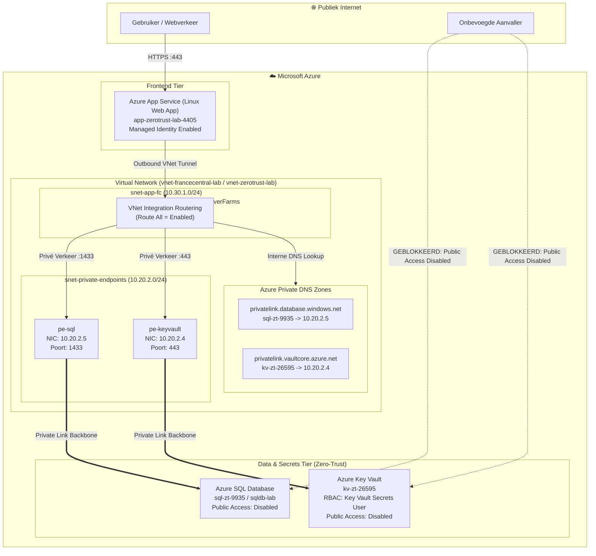

# Azure Zero-Trust PaaS Architecture Lab

> **Enterprise Zero-Trust PaaS architectuur op Microsoft Azure** — Volledige netwerk-isolatie en identiteitsbeveiliging van Azure App Service, Azure SQL Database en Azure Key Vault via Private Endpoints, Private DNS Zones, VNet-Integratie en Microsoft Entra ID Managed Identities.

---

## 📌 Architectuuroverzicht

Traditionele cloud-applicaties vertrouwen vaak op publieke IP-adressen met firewall-regels en statische connection strings. Dit lab implementeert het **Zero-Trust principe ("Never Trust, Always Verify", "Assume Breach")** door:
1. **Publieke toegang uit te schakelen (`publicNetworkAccess = Disabled`)** op zowel de data-tier (Azure SQL) als de secrets-tier (Azure Key Vault).
2. **Private Endpoints (Azure Private Link)** in te richten waardoor PaaS-diensten uitsluitend communiceren over interne IPv4-adressen (`10.20.2.x`).
3. **Azure Private DNS Zones** (`privatelink.database.windows.net` en `privatelink.vaultcore.azure.net`) te koppelen voor transparante CNAME-resolutie.
4. **Regional VNet Integration** met `Route All` te configureren op de Azure App Service.
5. **System-Assigned Managed Identity** en **Azure RBAC (`Key Vault Secrets User`)** toe te passen, waardoor statische wachtwoorden en connection strings overbodig zijn.



---

## 🛠️ Hybride Implementatie: CLI & Azure Portal

Het lab is bewust opgezet via een **hybride aanpak** om zowel automation/scripting als portal- en security engineering te demonstreren:

| Onderdeel | Methode | Uitgevoerde Acties |
| :--- | :--- | :--- |
| **Infrastructuur Fundament** | **Azure CLI / Cloud Shell** | Resource Groups, VNets, Subnet Delegation (`Microsoft.Web/serverFarms`), Private DNS Zones & VNet Links. |
| **PaaS & Private Endpoints** | **Azure CLI / Cloud Shell** | Key Vault met RBAC & Public Access Disabled, SQL Server & DB, Private Endpoints (`pe-keyvault`, `pe-sql`), DNS Zone Groups. |
| **Web App Provisioning** | **Azure Portal** | Linux App Service Plan, Web App instellingen, SKU configuratie. |
| **Netwerkintegratie** | **Azure Portal** | Regional VNet Integration koppeling, Toepassingsrouting / Route All activatie. |
| **Zero-Trust Identity & IAM** | **Azure Portal** | System-Assigned Managed Identity genereren, Azure RBAC toewijzing (`Key Vault Secrets User`). |
| **Validatie & Troubleshooting** | **SSH / CLI / Portal** | Public Access block verificatie, SSH DNS Lookups (`nslookup` naar 10.20.2.x). |

---

## 🧪 Validatie & Bewijsvoering

### 1. Publieke Toegang Keihard Geblokkeerd (Assume Breach)
Wanneer een gebruiker via het internet (zelfs via het Azure Portal) de Key Vault geheimen probeert in te zien, wordt dit direct geweigerd door het Zero-Trust beleid:
> `De bewerking is niet toegestaan door RBAC... U hebt geen machtiging om deze inhoud weer te geven.`

### 2. Private DNS & Netwerk Routering via SSH Console
Vanuit de Linux Web App SSH sessie resolven alle backend endpoints automatisch naar hun interne privé-adressen:
```bash
root@1e57e3e8b822:/home/site/wwwroot# nslookup sql-zt-9935.database.windows.net
Non-authoritative answer:
sql-zt-9935.database.windows.net       canonical name = sql-zt-9935.privatelink.database.windows.net.
Name:   sql-zt-9935.privatelink.database.windows.net
Address: 10.20.2.5

root@1e57e3e8b822:/home/site/wwwroot# nslookup kv-zt-26595.vault.azure.net
Non-authoritative answer:
kv-zt-26595.vault.azure.net            canonical name = kv-zt-26595.privatelink.vaultcore.azure.net.
Name:   kv-zt-26595.privatelink.vaultcore.azure.net
Address: 10.20.2.4
```

---

## 💡 Troubleshooting & Geleerde Lessen

Tijdens de uitrol zijn verschillende reële enterprise scenario's opgelost:
1. **Regionale Quota & Datacenter Capaciteit**: West Europe en North Europe hadden quota-restricties voor SQL en Linux VMs. Door de services flexibel te deployen in France Central en Private DNS links te benutten, werd dit direct omzeild.
2. **Resource Provider Registratie**: `Microsoft.KeyVault` en `Microsoft.Sql` moesten expliciet via de CLI worden geregistreerd in de subscription (`az provider register`).
3. **Subnet Delegatie**: Regional VNet Integration vereist strikt een subnet met delegatie naar `Microsoft.Web/serverFarms`.
4. **Wachtwoordloze Architectuur**: Het uitsluiten van connection strings ten gunste van Entra ID Managed Identity en Azure RBAC voorkomt credential leaks in Git.

---

## 📁 Repository Structuur

```text
azure-zero-trust-paas-lab/
├── documentatie/
│   ├── Azure_Zero_Trust_PaaS_Lab_Rapport.docx  # Het officiële, rijk opgemaakte Word rapport
│   └── zero-trust-paas-architectuur.md        # Volledige technische documentatie
├── scripts/
│   ├── deploy.ps1                             # PowerShell geautomatiseerde uitrol
│   ├── cleanup.ps1                            # Opruimscript om Azure kosten te voorkomen
│   └── generate_word_report.py                # Script voor Word-rapport generatie
├── Screenshots/                               # Alle 37 gevalideerde screenshots en foutoplossingen
└── README.md                                  # Portfolio documentatie
```
